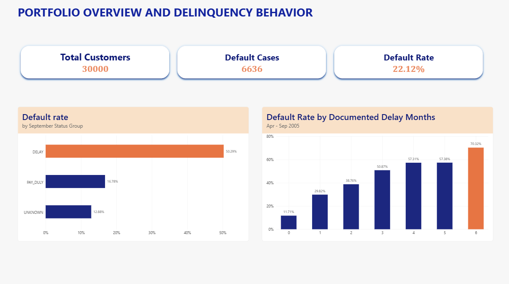
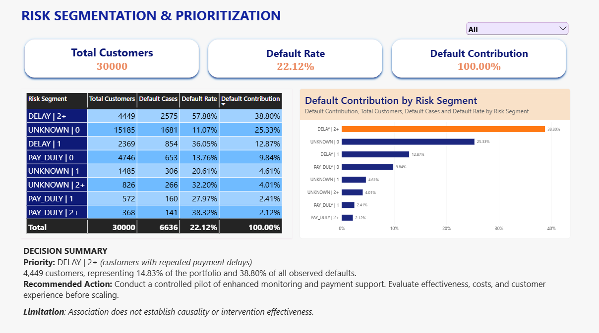
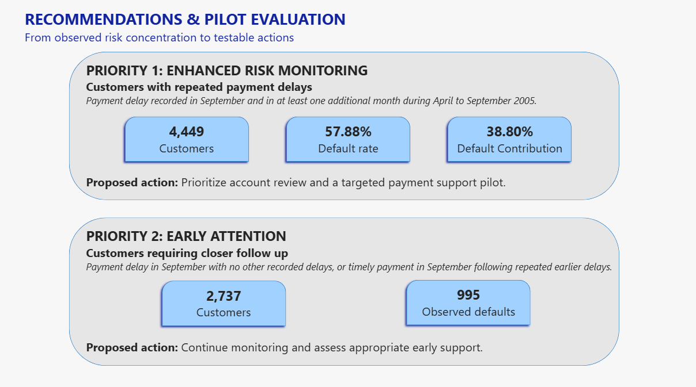

# Credit Card Delinquency Early Warning

**Credit risk analytics portfolio | SQL Server · Power BI | Historical case study**

> **Decision question:** Which credit card customers should receive closer risk monitoring when operational capacity is limited?

This independent case study uses the [UCI Default of Credit Card Clients dataset](https://archive.ics.uci.edu/dataset/350/default+of+credit+card+clients), covering **30,000 customers** in Taiwan, repayment history from April to September 2005, and a subsequent default outcome. The stakeholder scenario and proposed monitoring capacity are illustrative; the numerical findings come from the historical data.

## Executive summary

**The priority monitoring candidate represents only 14.83% of customers but accounts for 38.80% of observed defaults.** It consists of customers with a documented payment delay in September and at least one additional documented delay month within the six month observation period. These months do not need to be consecutive.

| Measure | Full portfolio | Priority 1 |
|:--|--:|--:|
| Customers | 30,000 | **4,449** |
| Observed defaults | 6,636 | **2,575** |
| Default rate | 22.12% | **57.88%** |
| Share of customers | 100% | **14.83%** |
| Share of observed defaults | 100% | **38.80%** |

**Business recommendation:** Prioritize eligibility and account review in this concentrated segment, then evaluate enhanced monitoring and appropriate payment support through a controlled pilot. The segment's historical default share is not an estimate of how many defaults could be prevented.

**Start here:** [Final analytical report](report/Final_Analytical_Report.pdf) · [Stakeholder presentation](presentation/Stakeholder_Presentation.pdf) · [Power BI report](dashboard/CreditRiskAnalytics.pbix)

## Power BI dashboard preview

The following screenshots show the final three report pages. Download the `.pbix` file to explore the report in Power BI Desktop. There is no public Power BI Service link.

### 1. Portfolio overview and delinquency behavior



**What it shows:** The portfolio default rate is **22.12%**. Customers with more months of documented payment delays generally have higher observed default rates, increasing from **11.71%** in the zero documented delay month group to **70.32%** in the six month group. A zero count does not guarantee a fully on time payment history because some status codes are classified as unknown.

### 2. Risk segmentation and prioritization



**What it shows:** The analysis combines September repayment status with the number of documented delay months to identify eight mutually exclusive segments. The leading monitoring candidate accounts for **38.80%** of defaults while making up **14.83%** of customers.

### 3. Recommendations and pilot evaluation



**What it shows:** Priority 1 consists of **4,449** customers with repeated recorded delays. Priority 2 includes **2,737** customers who have either one documented delay in September or are recorded as paying on time in September after at least two documented earlier delay months. The pilot proposal calls for an eligibility review and measured comparison of intervention outcomes.

## From business problem to analysis

| Business question | Analytical response | Evidence |
|:--|:--|:--|
| Where is default risk concentrated? | Measure default rate, cases and contribution at customer level | [Segmentation SQL](sql/06_risk_segmentation.sql) |
| Does payment history matter beyond recent status? | Compare default rates across six month delay histories and recent repayment status transition groups | [Behavior baseline](sql/03_behavioral_baseline.sql), [Status transition SQL](sql/05_delinquency_migration.sql) |
| Where should monitoring begin? | Combine risk intensity, customer volume and default concentration; inspect financial context | [Financial context SQL](sql/07_financial_context.sql), [Report](report/Final_Analytical_Report.pdf) |
| Can the findings support a reliable decision? | Audit source values, row grain, duplicates and reconciliation | [Data quality SQL](sql/02_data_quality_audit.sql), [Analytical model SQL](sql/04_analytical_model.sql) |

### Selected findings

**Repayment history adds useful context.** Even among customers coded as paying on time in September, the observed default rate is **13.76%** for customers with zero documented delay months and **38.32%** for customers with two or more. This supports using payment history alongside recent status for descriptive segmentation.

**Monthly repayment status transitions add context.** From August to September, customers classified as `DELAY` in both months had a **57.78%** observed default rate, compared with **24.66%** for the `PAY_DULY` to `DELAY` group. These transitions compare project-defined status groups, not changes in the underlying delay code or Days Past Due (DPD). For example, raw code 1 to 2 and raw code 2 to 1 are both classified as `DELAY` to `DELAY`. These are descriptive historical associations.

**Risk intensity and volume are different.** Priority 1 has **57.88%** observed default rate and **2,575** observed defaults. A second monitoring tier of **2,737** customers contains **995** observed defaults. Prioritization should also account for eligibility, capacity, cost and customer experience.

## Data definitions and quality controls

| Data layer | One row represents | Rows |
|:--|:--|--:|
| `dbo.credit_card_raw` | One customer | 30,000 |
| `dbo.vw_credit_customer_month` | One customer in one month | 180,000 |
| `dbo.vw_credit_customer_features` | One customer | 30,000 |

**Observed default rate** = customers with `DEFAULT_NEXT_MONTH = 1` in a group / all customers in that same group. For the full sample, this is 6,636 / 30,000 = 22.12%.

**Default contribution** = customers with `DEFAULT_NEXT_MONTH = 1` in a segment / 6,636 observed default cases across the full portfolio. This denominator stays portfolio-wide even when comparing segments.

**Transition share** = number of transitions from one status group to a destination group / all transition instances that started from that same status group. These count monthly transitions, not distinct customers.

**Data validation matters:** The customer outcome is repeated on six customer month rows. Therefore, **6,636** unique default customers correspond to **39,816** customer month rows carrying the default flag. Counting rows instead of people would overstate default cases sixfold. The SQL scripts reconcile row counts and outcomes, check uniqueness and inspect repayment and financial codes.

**Repayment status policy:** The UCI feature description documents code `-1` as paying duly and codes `1` to `9` as payment delays. It does not explain the observed codes `-2` and `0`. The `UNKNOWN` label is therefore an explicit project classification for codes whose meaning has not been confirmed. Raw codes are retained, and `UNKNOWN` is neither automatically treated as paying on time nor as delayed. A data owner should confirm those definitions before operational use.

| Raw repayment status | Evidence from UCI description | Project label | Analytical treatment |
|:--|:--|:--|:--|
| `-1` | Described as paying duly | `PAY_DULY` | Separate category in segmentation |
| `1` through `9` | Described as payment delays | `DELAY` | Count as a documented delay month |
| `-2`, `0` | Present in records, but not defined in the cited description | `UNKNOWN` | Preserve the original value; do not count as documented delay |
| Any unforeseen code | Requires review against updated source documentation | `UNKNOWN` | Preserve and investigate before assigning a business meaning |

**Transition group definitions (August to September):**

| Analytical group | Interpretation |
|:--|:--|
| `REMAINED_IN_DELAY` | Recorded in the `DELAY` group in both months; raw delay severity may still have changed |
| `ENTERED_DELAY_FROM_PAY_DULY` | Moved from `PAY_DULY` to `DELAY` between those two observations |
| `EXITED_DELAY_TO_PAY_DULY` | Moved from `DELAY` to `PAY_DULY`; not proof that every balance was repaid |
| `UNKNOWN_INVOLVED` | At least one of the two monthly codes is in `UNKNOWN` |

**Financial context:** Mean bills, payments and credit limits describe the segments; they are not independently verified exposure at default, loss given default, or expected loss. Payment to bill timing is not established sufficiently to infer a missed payment from a simple ratio.

## Recommended decision and evaluation

**Priority 1:** Review the **4,449** customers with a documented delay in September and at least one other documented delay month. Assess a payment support or enhanced monitoring pilot with a treatment group and a suitable control group.

**Priority 2:** Monitor the additional **2,737** customers with recent or earlier recorded delay patterns and evaluate lighter interventions where appropriate.

**Evaluation:** Specify eligibility and contact permissions; measure next period default outcomes, delivery and contact rates, cost, complaints and customer experience; expand only when the evidence supports the intervention. The illustrative capacity of **5,000 proactive contacts** describes the resource allocation question, not verified operating capacity.

## Repository structure

```text
.
├── README.md
├── dashboard/
│   ├── CreditRiskAnalytics.pbix
│   ├── 01_portfolio_overview.png
│   ├── 02_risk_segmentation.png
│   └── 03_recommendations.png
├── sql/
│   ├── 00_database_setup.sql
│   ├── 01_raw_data_validation.sql
│   ├── 02_data_quality_audit.sql
│   ├── 03_behavioral_baseline.sql
│   ├── 04_analytical_model.sql
│   ├── 05_delinquency_migration.sql
│   ├── 06_risk_segmentation.sql
│   └── 07_financial_context.sql
├── report/
│   ├── Final_Analytical_Report.pdf
│   └── Final_Analytical_Report.docx
└── presentation/
    ├── Stakeholder_Presentation.pdf
    └── Stakeholder_Presentation.pptx
```

## Reproduce the analysis

**Requirements:** Microsoft SQL Server and SQL Server Management Studio (SSMS). The optional `BULK INSERT ... FORMAT = 'CSV'` example in Script 00 requires SQL Server 2017 or later and file access from the SQL Server service. Power BI Desktop is needed to open the `.pbix` report. Exact product build numbers from the original workstation were not recorded.

1. Download the original **`default of credit card clients.xls`** from [UCI](https://archive.ics.uci.edu/dataset/350/default+of+credit+card+clients). Open the worksheet and inspect its two header rows: the variable identifier row (`X1`, etc.) and the actual field-name row (`ID`, `LIMIT_BAL`, etc.). Keep only the 30,000 customer records and a **single** CSV header row with the 25 names shown below. Do not alter data values or add an Excel index column. Save as a UTF-8 CSV with comma delimiters and without thousands separators.
2. Run [`sql/00_database_setup.sql`](sql/00_database_setup.sql) in SSMS. It creates `CreditRiskAnalytics` and the 25-column `dbo.credit_card_raw` table only if absent; it does not delete any existing data. Use the commented `BULK INSERT` example in the script after changing the example path to one **accessible to the SQL Server service**. Execute the import statement once. If the file path is not accessible to SQL Server, see the alternate wizard route below.
3. Confirm exactly **30,000 rows and 30,000 distinct IDs**. Run `sql/01_raw_data_validation.sql` through `sql/07_financial_context.sql` in order in SSMS. Script 04 creates the two analytical views; subsequent scripts read them. These are the versions used in the confirmed analysis; preliminary experiments are excluded.
4. Confirm the key controls: 30,000 raw customers, 180,000 customer month observations, 30,000 feature rows, 6,636 default customers, no duplicate customer month pairs, and complete six month histories.
5. Open `dashboard/CreditRiskAnalytics.pbix` in Power BI Desktop. The report includes imported model data; refreshing from SQL Server on another computer may require updating the data source connection. If recreating from SQL views, use a single direction one to many relationship from customer features to customer month on `customer_id`.
6. Reconcile KPI and segment results with `sql/06_risk_segmentation.sql` and the analytical report. Do not sum repeated default flags at the customer month grain.

**CSV column order for the import (25 columns):**

```text
ID,LIMIT_BAL,SEX,EDUCATION,MARRIAGE,AGE,PAY_0,PAY_2,PAY_3,PAY_4,PAY_5,PAY_6,BILL_AMT1,BILL_AMT2,BILL_AMT3,BILL_AMT4,BILL_AMT5,BILL_AMT6,PAY_AMT1,PAY_AMT2,PAY_AMT3,PAY_AMT4,PAY_AMT5,PAY_AMT6,DEFAULT_NEXT_MONTH
```

**Alternate SSMS route:** If SQL Server cannot read a CSV path with `BULK INSERT`, use **Tasks → Import Flat File** with the clean CSV. This wizard **creates a new table**, so first create only the database (the first block of Script 00) and do **not** create `dbo.credit_card_raw` beforehand. Name the wizard's destination table `dbo.credit_card_raw`, check every inferred data type against the DDL in Script 00, and confirm the 25 columns, 30,000 records and default count. Do not use the wizard to overwrite an existing raw table. On systems without the wizard, arrange access for server-side `BULK INSERT` rather than silently changing the source values.

**Quality assurance summary (confirmed during the project):**

| Validation check | Observed result |
|:--|--:|
| Unique raw customer IDs | 30,000 |
| Customer-month records | 180,000 |
| Customer-level feature rows | 30,000 |
| Observed default cases (customer grain) | 6,636 |
| Duplicate customer/month pairs | 0 |
| Customers without six observed months | 0 |
| Adjacent-month status transition instances | 150,000 |

These are the validated results from the original analysis, not a claim that the new setup/import instructions have been independently executed on a fresh SQL Server installation.

## Scope and source

This is an observational study of a **2005 Taiwanese credit card sample** with a single subsequent default outcome for each customer. No independent time based predictive validation or measured intervention effects are available. The proposed monitoring strategy is a basis for evaluation, not an automated credit decision policy.

**Dataset attribution:** Yeh, I. (2009). *Default of Credit Card Clients* [Dataset]. UCI Machine Learning Repository. [DOI: 10.24432/C55S3H](https://doi.org/10.24432/C55S3H). [UCI dataset page](https://archive.ics.uci.edu/dataset/350/default+of+credit+card+clients). The UCI dataset is licensed under [Creative Commons Attribution 4.0 International (CC BY 4.0)](https://creativecommons.org/licenses/by/4.0/).

**Associated research article:** Yeh, I. C. and Lien, C. H. (2009). *The comparisons of data mining techniques for the predictive accuracy of probability of default of credit card clients*. *Expert Systems with Applications*.
