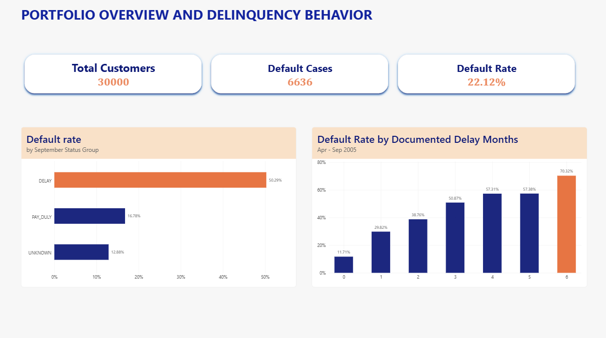
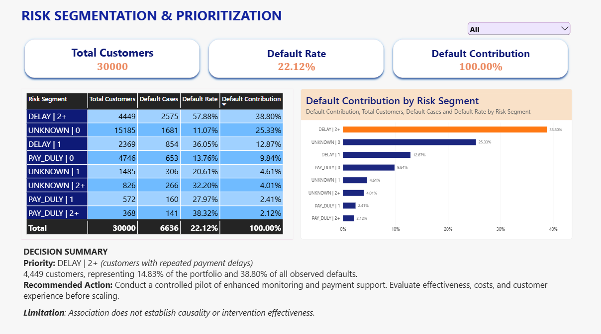
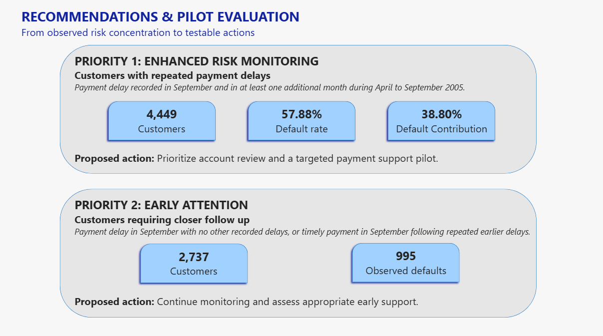

# Power BI deliverable

Open [CreditRiskAnalytics.pbix](CreditRiskAnalytics.pbix) in Power BI Desktop. The final report pages are shown in the three screenshots below. The PBIX includes imported data for a historical public dataset; refreshing it may require changing the original SQL Server connection.

**Verified against user reported SQL results:** 30,000 customers, 6,636 observed default cases, 22.12% portfolio default rate; Priority 1 includes 4,449 customers, 57.88% default rate and 38.80% contribution.

**Before making the PBIX public:** Open Power BI Desktop → File → Options and settings → Data source settings; inspect whether the source connection reveals your computer/server name or other private metadata. Review the report's imported data and queries. The PBIX is not an online Power BI Service link.
